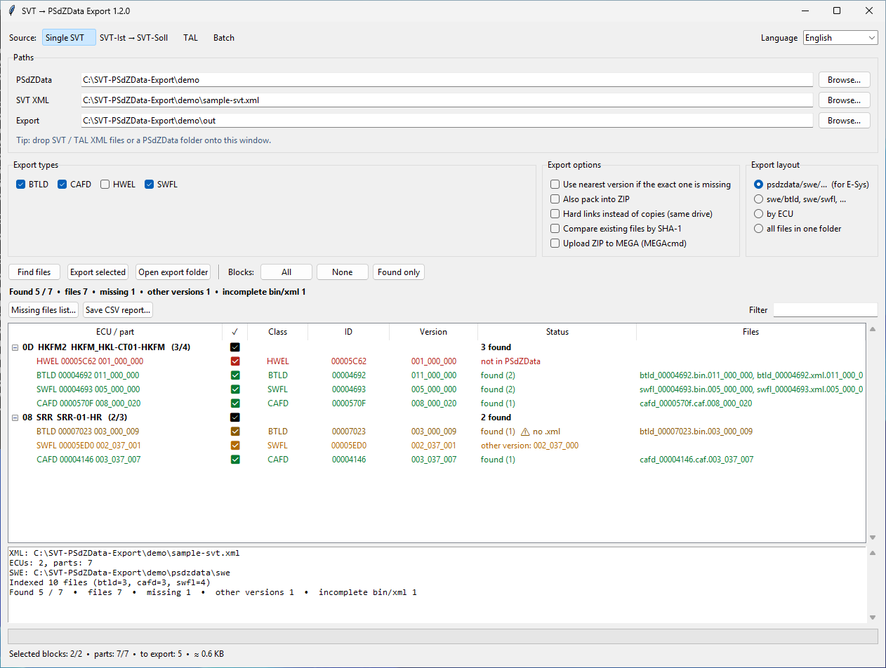
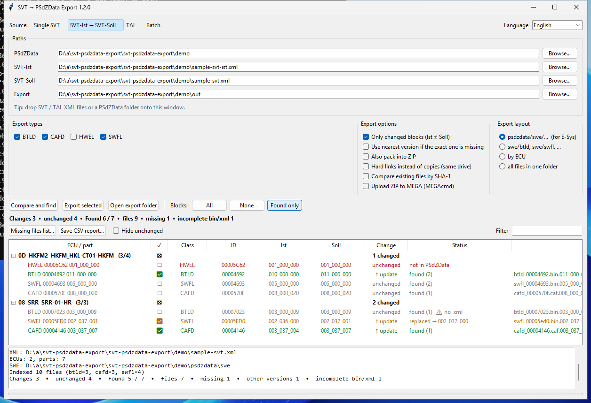
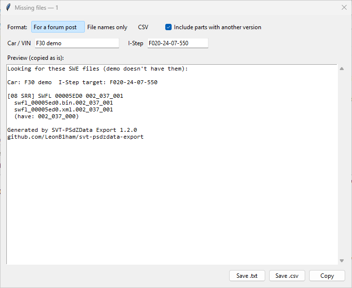
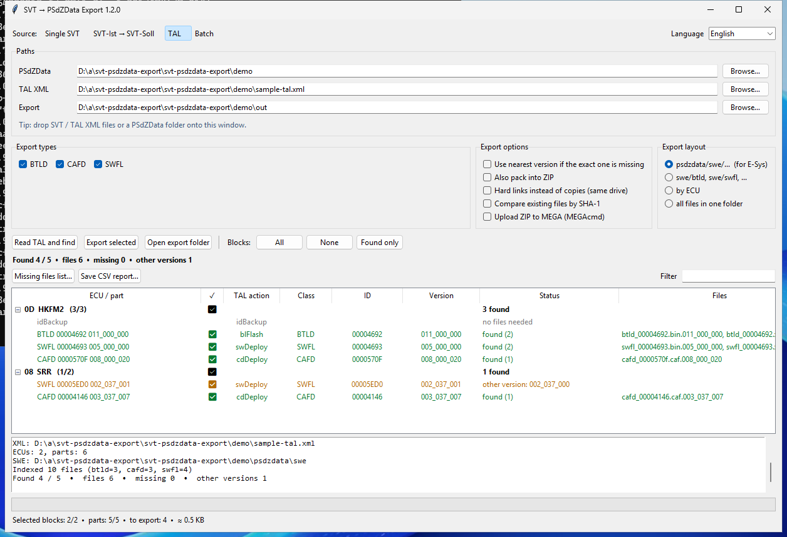
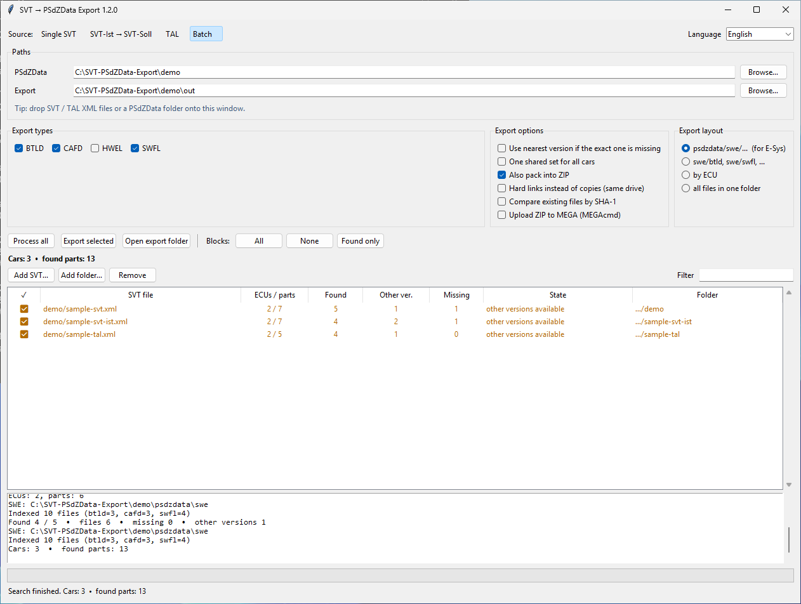
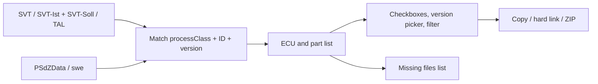

# SVT → PSdZData Export

**Version 1.2.0** — Windows tool that reads a BMW **SVT** or **TAL** XML, finds the matching SWE files in **PSdZData**, and copies only what you need into a folder.

Use it to build a small `psdzdata/swe` set for one car (CAFD / BTLD / SWFL / SWFK) instead of shipping the full dataset.

UI languages: **English, Deutsch, Українська, Русский**. First launch follows the Windows UI language. You can change it in the window; the choice is stored in `svt_export.json`.

Download the ready `SVT-PSdZData-Export.exe` from [Releases](https://github.com/LeonB1ham/svt-psdzdata-export/releases). Python is not required.

## What's new in 1.2.0

- **SVT-Ist → SVT-Soll**: load the current and the target SVT; the tool shows Ist and Soll versions side by side and by default exports only the blocks that change
- **TAL mode**: load a TAL from E-Sys and export exactly the files its `blFlash` / `swDeploy` / `cdDeploy` actions need
- **Missing files list**: ready-to-paste text for a forum post (with car / VIN and I-Step), a plain file-name list, or CSV
- **Other version picker**: right-click (or double-click) a part to use another version that is in PSdZData; optional automatic nearest version. Replacements are written to the manifest
- **bin/xml check**: warns when a BTLD/SWFL/SWFK has only the `.bin` or only the `.xml`
- **Batch mode**: several SVT/TAL files in one run, one subfolder per car (or one shared set) plus `batch_report.csv`
- **Export options**: also pack into ZIP, hard links instead of copies (same drive), compare existing files by SHA-1
- **Upload to MEGA**: the ZIP goes to your MEGA account and you get a public link (copied to the clipboard), ready to share on a forum
- **Filter** box, **drag & drop** of SVT/TAL files and PSdZData folders onto the window (or onto the exe), CSV report of the whole table

## Screenshots

Single SVT: found parts in green, other version in orange, missing in red, a BTLD with only its `.bin` gets a warning.



SVT-Ist → SVT-Soll: only the changed blocks are checked; the missing SWFL is replaced by the nearest version from PSdZData.



Missing files list, ready for a forum post:



TAL mode with the TAL action of every part:



Batch mode, several cars in one run:



## How it works



- Parses each ECU from the SVT: diagnostic address, `baseVariant`, `nameBNTN`, every `partIdentification`
- In Ist → Soll mode, compares parts by ECU (address + base variant) and `processClass` + ID: **update**, **new**, or **unchanged**
- In TAL mode, reads every `talLine` and its actions; actions without files (`idBackup`, `fscDeploy`, …) are listed for reference
- Indexes `psdzdata/swe/{btld,swfl,swfk,cafd,...}` and matches names such as `cafd_00004146.caf.003_037_007`
- Marks rows as **found**, **missing**, **other version available**, **replaced**, or **incomplete bin/xml**
- Exports only checked blocks and types and writes `svt_export_manifest.txt`

## Run

Python 3 (`py -3`):

```bat
start.bat
```

or

```bat
py -3 app.py
```

Optional, for drag & drop onto the window when running from source: `py -3 -m pip install tkinterdnd2` (the exe already has it).

Force a language:

```bat
py -3 app.py --lang en
```

1. Pick a source at the top: **Single SVT**, **SVT-Ist → SVT-Soll**, **TAL** or **Batch**
2. Set the PSdZData folder (Lite/Full root or `psdzdata` itself), the XML file(s) and the export folder — or drop them onto the window
3. Click **Find files** / **Compare and find** / **Read TAL and find** / **Process all**
4. Check blocks: **All** / **None** / **Found only** / checkboxes on an ECU or a single part
5. Right-click a part with another version available to pick a replacement
6. **Export selected**; **Missing files list…** gives you the text to ask for the rest

Build a standalone exe: `.\build.ps1` → `dist\SVT-PSdZData-Export.exe`. Tagged releases are built by GitHub Actions (`.github/workflows/build.yml`).

## Demo

`demo/` ships sample SVT-Ist / SVT-Soll / TAL files and a tiny fake PSdZData. There are no real BMW binaries — only placeholders so you can see every status.

```bat
.\demo\run-demo.ps1
```

GUI on demo data:

```bat
py -3 app.py --demo
```

Expected result for `demo\sample-svt.xml`:

| ECU | Part | Result |
|---|---|---|
| `0D HKFM2` | BTLD `00004692` `011_000_000` | found (bin + xml) |
| `0D HKFM2` | SWFL `00004693` `005_000_000` | found (bin + xml) |
| `0D HKFM2` | CAFD `0000570F` `008_000_020` | found |
| `0D HKFM2` | HWEL `00005C62` | no file (expected) |
| `08 SRR` | BTLD `00007023` `003_000_009` | found, **only .bin** (warning) |
| `08 SRR` | SWFL `00005ED0` `002_037_001` | missing, **other version** `002_037_000` present |
| `08 SRR` | CAFD `00004146` `003_037_007` | found (older `003_037_004` also present) |

`demo\sample-svt-ist.xml` has older BTLD (HKFM2), SWFL and CAFD (SRR), so Ist → Soll shows 3 changed blocks. `demo\sample-tal.xml` is the matching TAL.

Reference manifest: [`demo/export-example/svt_export_manifest.txt`](demo/export-example/svt_export_manifest.txt).

On a full PSdZData the placeholders become real `.bin` / `.caf` / `.xml` files. **Lite** packs often have `swe/cafd` only — BTLD/SWFL stay red. That is normal.

## CLI

```bat
py -3 app.py --svt "C:\path\svt.xml" --psdz "C:\PSdZData 4.60.11 Lite" --out "D:\export"
```

| Option | Meaning |
|---|---|
| `--svt FILE` | SVT (with `--soll`: the current SVT-Ist) |
| `--soll FILE` | target SVT-Soll; exports only what changes (`--all-parts` for everything) |
| `--tal FILE` | TAL from E-Sys |
| `--batch FILE…` | several SVT/TAL files, one subfolder per car |
| `--layout` | `psdzdata` (default, handy for E-Sys) · `swe` · `ecu` (one folder per ECU) · `flat` |
| `--nearest` | use the nearest version when the exact one is missing |
| `--zip` | also pack the export folder into `<folder>.zip` |
| `--hardlink` | hard links instead of copies (same drive; falls back to copy) |
| `--hash` | compare existing files by SHA-1, not only by size |
| `--missing-report FILE` | write the missing-files list (`.txt` forum text or `.csv`) |
| `--mega [REMOTE_DIR]` | upload the ZIP to MEGA via MEGAcmd and print the public link |

You can also drop SVT/TAL files onto `SVT-PSdZData-Export.exe` to open them.

## MEGA upload

Uses the official free **MEGAcmd** from MEGA, so no password is stored in this tool:

1. Install MEGAcmd from [mega.io/cmd](https://mega.io/cmd)
2. Open MEGAcmd once and log in: `login your@email password`
3. Tick **Upload ZIP to MEGA (MEGAcmd)** (or use `--mega` in the CLI)

After the export the ZIP is uploaded to `/SVT-Export` in your MEGA account (CLI: `--mega "/my/folder"`), a public link is created and copied to the clipboard. In batch mode every car gets its own link, also written to `batch_report.csv`.

## Notes

- HWEL/HWAP are off by default; they are usually not SWE binaries
- The same file used by several ECUs is copied once
- An existing file of the same size is skipped (with **SHA-1** on: only if the content is the same)
- A replaced version keeps its real file name — E-Sys will still ask for the version from the SVT/TAL, so use replacements with care (mostly for CAFD)
- Last paths, mode, options and language are stored in `svt_export.json` next to the app
